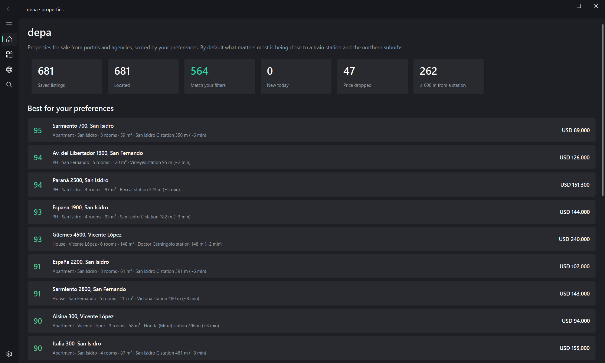
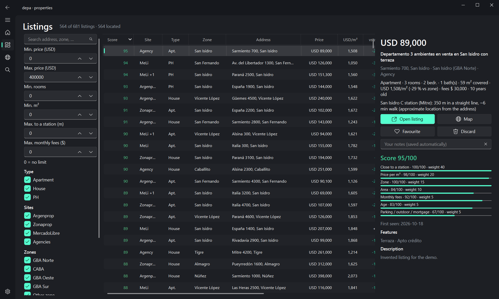
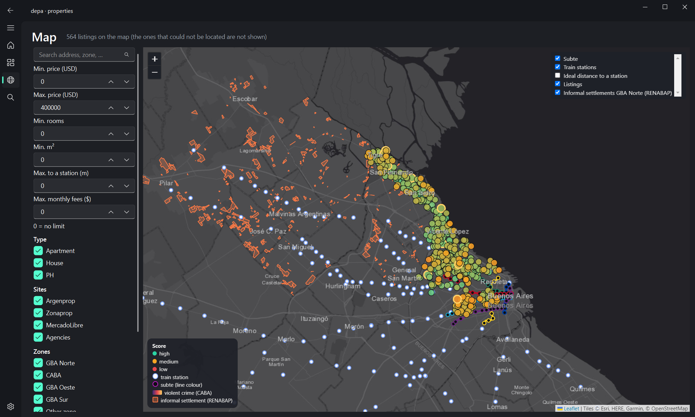
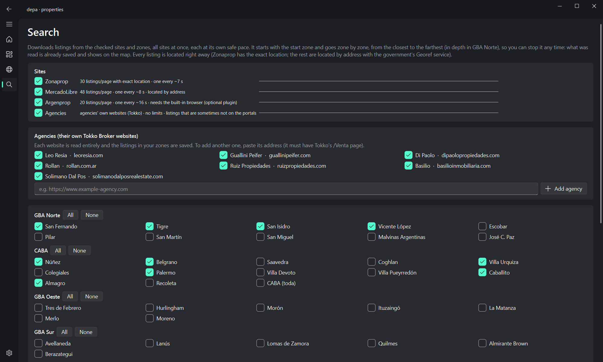
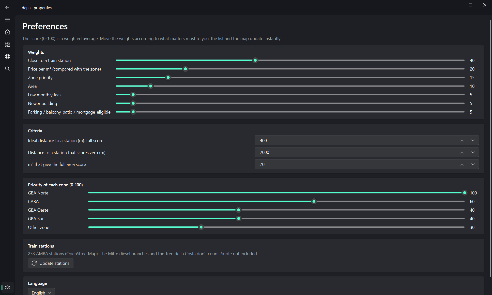

# depa

A Windows desktop app that collects properties for sale in Greater Buenos Aires from the big real-estate portals and from agencies' own websites. It puts them all on one map and ranks them by what matters to you.



## Why I built it

I wanted to buy an apartment, and looking for one was harder than it should have been. The main portals have dated interfaces. Their maps also don't show every property that's for sale: a listing could be on the site but never appear on the map. Comparing across sites meant checking the same houses over and over.

So I wrote my own scraper. It downloads the sale listings, puts every one on a map, finds the copies of the same property on different sites, and scores each one against my priorities: distance to a train station, price per m² compared with the rest of the zone, and so on. That let me see which ones were actually the best for me.

## What it does

- **Collects listings** from Zonaprop, MercadoLibre, Argenprop and agency websites built on Tokko Broker. It reads the sites slowly, one page every few seconds, and backs off when a site refuses a page.
- **Locates every listing**, from the portal's own pin when there is one and otherwise from the address. Addresses are matched with the Argentine government's [Georef](https://datosgobar.github.io/georef-ar-api/) service, with OpenStreetMap's Nominatim as a fallback. Pins that land outside Greater Buenos Aires are ignored.
- **Finds duplicates:** the same property on several sites (same type, within 150 m, price within 3 %, area within 8 %) is shown once, with links to the other copies.
- **Scores each listing from 0 to 100** with weights you can change:

  | Criterion | Default weight |
  |---|---|
  | Walking distance to a train station | 40 |
  | Price per m² compared with the median of its zone and type | 20 |
  | Zone priority | 15 |
  | Covered area | 10 |
  | Monthly fees, age, extras (parking, balcony, eligible for a mortgage) | 5 each |

- **Map layers** from open data: train stations and subte lines (OpenStreetMap), informal settlements (RENABAP), and violent-crime density in CABA (Buenos Aires open data).
- **Tracks prices** between runs and flags the listings that dropped.
- **Interface in English or Spanish**, chosen in Preferences.

| Listings | Map |
|---|---|
|  |  |
| **Search** | **Preferences** |
|  |  |

*The screenshots show invented demo data (see below), not real listings.*

## Architecture

```
depa_app/
├── domain/         pure logic, no I/O: scoring, duplicate detection, filters, geo maths, zones
├── sources/        one module per site (search URL + HTML/JSON parser) and the polite HTTP client
├── repositories/   SQLite access (listings, price history, flags)
├── opendata/       stations, subte, geocoding, safety layers (public APIs, cached on disk)
├── services/       use cases without Qt: Catalog (load + score + filter), ScrapeRun (one download run)
├── ui/             PySide6 + Fluent widgets; thin wrappers that call the services
├── translations/   Spanish texts for i18n.tr()
└── plugins.py      optional extensions loaded if present (not part of this repository)
```

- Adding a site means adding one module to `sources/` with `search_url()` and `parse_list()`, and registering it in `SOURCES`. Nothing else changes.
- The services take their collaborators as parameters, so they're tested with fakes. Qt only lives in `ui/`.
- One small piece is not in this repository: the optional plugin Argenprop needs (that site only serves its pages to a real browser). Without it the app works the same and skips Argenprop.

## Run it

Requires Windows and Python 3.12.

```bat
python -m venv venv
venv\Scripts\pip install -r requirements.txt
venv\Scripts\python main.py
```

To try it without downloading anything, create the demo data and point the app at it:

```bat
venv\Scripts\python scripts\demo_data.py demo_data
set DEPA_DATA_DIR=demo_data
venv\Scripts\python main.py
```

## Tests

```bat
venv\Scripts\pip install pytest
venv\Scripts\python -m pytest
```

84 unit tests cover:

- the domain (scoring, filters, duplicates, the area check)
- each site parser, on small synthetic pages in `tests/fixtures/`
- the HTTP client with a fake session
- the services, with a fake site and an in-memory database
- a check that every interface text has a Spanish translation

They run on every push in GitHub Actions.

## Note

This is a personal project for finding a home. It reads public listings slowly, about one page every few seconds per site, and keeps the data on your own PC.
